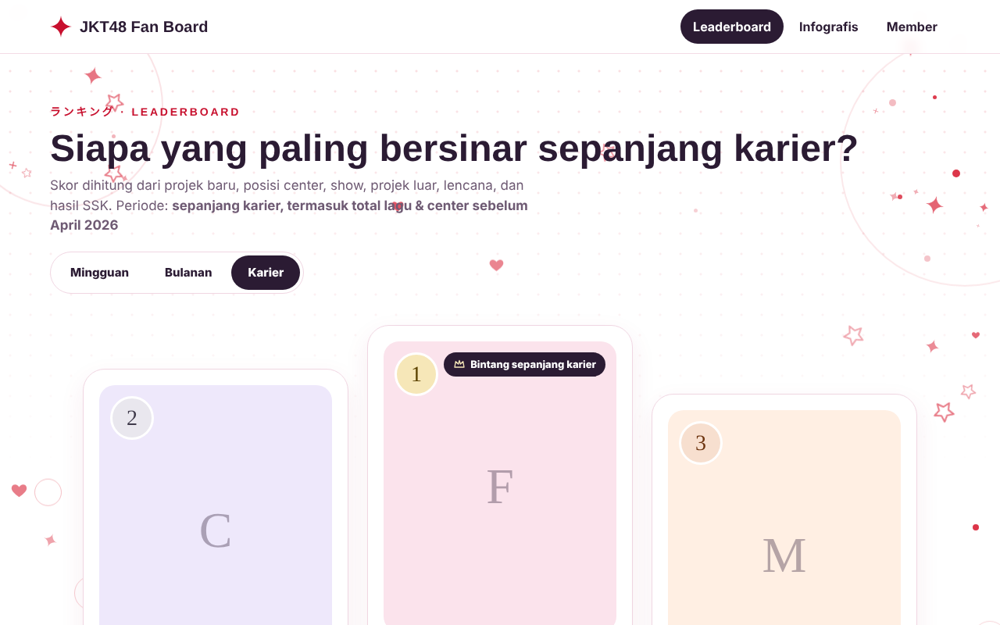
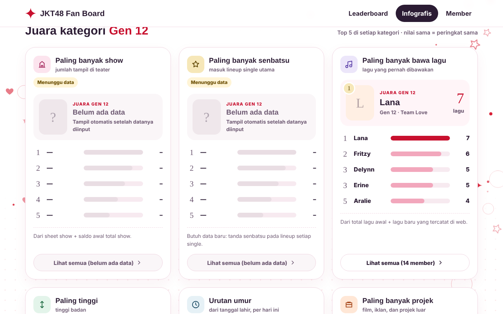
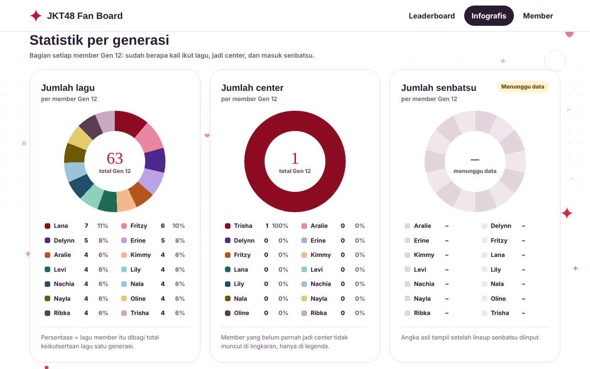
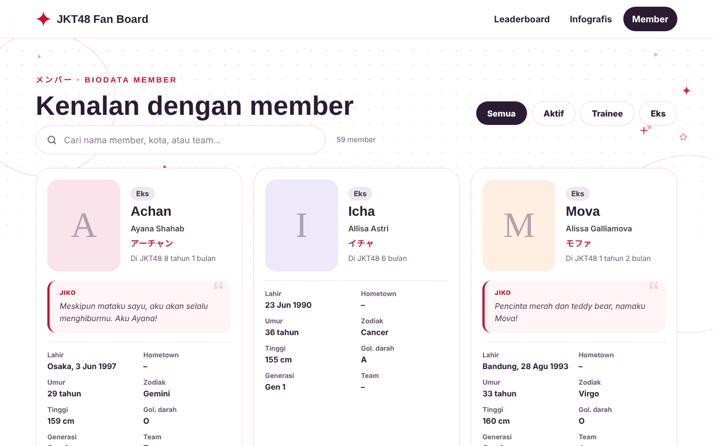
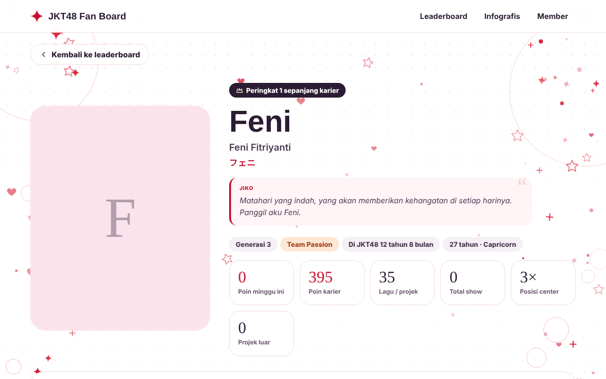
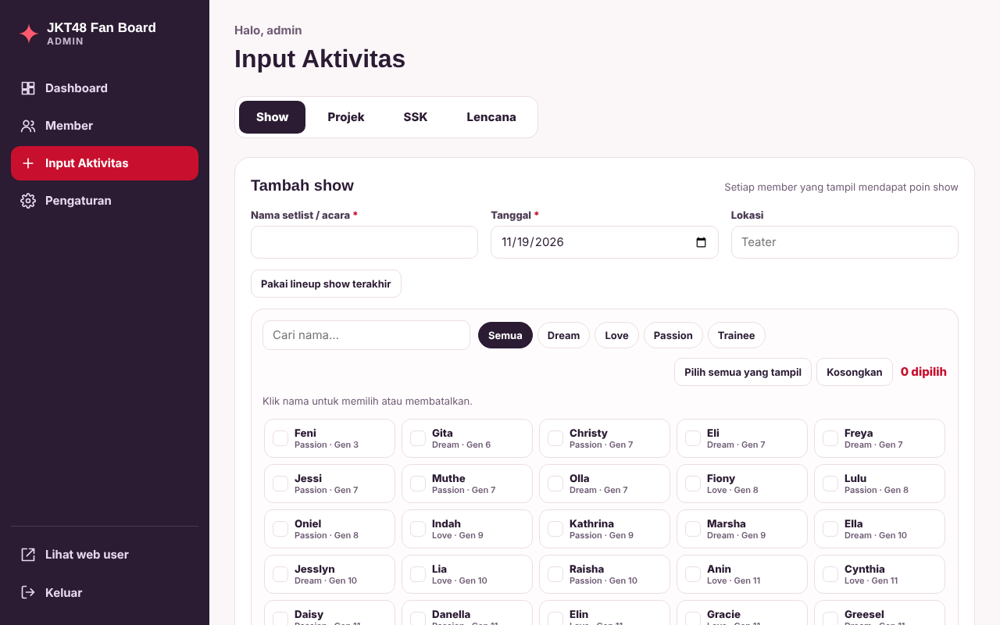
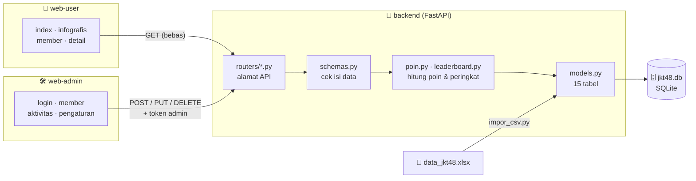

<div align="center">



<h3>✦ Papan peringkat progres member JKT48, dibuat oleh fans untuk fans ✦</h3>

<p>
  
  
  
  
</p>
<p>
  
  
  
</p>

<a href="#-tampilan">Tampilan</a> ·
<a href="#-fitur">Fitur</a> ·
<a href="#-cara-poin-dihitung">Sistem poin</a> ·
<a href="#%EF%B8%8F-cara-kerjanya">Cara kerja</a> ·
<a href="#-cara-menjalankan">Menjalankan</a> ·
<a href="#-daftar-api">API</a> ·
<a href="#%EF%B8%8F-rencana-berikutnya">Roadmap</a>

</div>

---

## 🌸 Tentang proyek ini

**JKT48 Fan Board** adalah fansite bergaya *idol Jepang yang kawaii tapi elegan*: latar putih dengan corak merah yang berkedip, kartu-kartu lembut, dan angka besar yang mudah dibaca.

Isinya tiga hal:

- 🏆 **Leaderboard**: siapa member yang paling bersinar minggu ini, bulan ini, atau sepanjang karier. Poin dihitung dari show, lagu, posisi center, SSK, projek luar, dan lencana kapten. Ada juga **streak**, yaitu berapa minggu berturut-turut seorang member bertahan di Top 5.
- 📊 **Infografis**: siapa yang paling banyak membawakan lagu, paling tinggi, tertua atau termuda, dan bagaimana pembagiannya per generasi.
- 💌 **Biodata member**: tempat dan tanggal lahir, umur, zodiak, golongan darah, tinggi, generasi, team, nama Jepang, sampai jiko (salam perkenalan).

Proyek ini juga tempatku **belajar membuat API dan machine learning** dari nol, jadi kodenya sengaja diberi banyak komentar berbahasa Indonesia. 📝

---

## 📸 Tampilan

<table>
  <tr>
    <td width="50%"><br><sub><b>Leaderboard</b>: podium Top 3, tab Mingguan / Bulanan / Karier</sub></td>
    <td width="50%"><br><sub><b>Infografis</b>: juara kategori, bisa per generasi</sub></td>
  </tr>
  <tr>
    <td width="50%"><br><sub><b>Diagram lingkaran</b>: bagian setiap member di satu generasi</sub></td>
    <td width="50%"><br><sub><b>Member</b>: biodata, nama Jepang &amp; jiko, pencarian</sub></td>
  </tr>
  <tr>
    <td width="50%"><br><sub><b>Detail member</b>: rincian poin, peringkat, grafik</sub></td>
    <td width="50%"><br><sub><b>Panel admin</b>: input show, projek, SSK, lencana</sub></td>
  </tr>
</table>

---

## ✨ Fitur

<details open>
<summary><b>🎀 Web user</b> (yang dilihat penggemar)</summary>

| Halaman | Isinya |
|---|---|
| **Leaderboard** `index.html` | Podium Top 3 dengan mahkota, peringkat 4–12, dan tombol untuk melihat semua peringkat. Tab **Mingguan / Bulanan / Karier**, tanda ▲▼ naik-turun, 🔥 streak Top 5, dan profil grup JKT48 di bawahnya. |
| **Infografis** `infografis.html` | 6 kartu juara: show, senbatsu, lagu, tinggi, umur (tertua/termuda), dan projek. Setiap kartu punya tombol **Lihat semua** untuk peringkat lengkap. Ada diagram lingkaran lagu, center, dan senbatsu, per generasi atau per member. |
| **Member** `member.html` | Kartu biodata lengkap dengan filter Aktif / Trainee / Eks dan kotak pencarian. Foto kapten diberi bingkai emas 👑. |
| **Detail** `detail.html` | Hero member, ubin statistik, rincian poin minggu ini, grafik peringkat 8 minggu, dan daftar projek. |
| **Prediksi AI** `prediksi.html` | 🤖 Tebakan machine learning: peluang masuk **senbatsu** single berikutnya, urutan **SSK** berikutnya, **kelompok member** menurut pola karier, dan pencarian **member yang kariernya mirip**. |

</details>

<details>
<summary><b>🛠️ Web admin</b> (panel pengelola, wajib login)</summary>

- 🔐 Login dengan **token JWT** yang berlaku 8 jam.
- 👥 **Member**: tambah, edit, dan hapus biodata, termasuk saldo awal karier.
- ➕ **Input aktivitas** dalam 4 tab:
  - **Show**, dengan pemilih lineup dan tombol "pakai lineup show terakhir".
  - **Projek**, dengan tanda center ⭐.
  - **SSK** (jumlah peringkat & senbatsu bisa diatur), dengan peringatan kalau ada nama yang dobel.
  - **Lencana kapten** (kapten team atau kapten global).
- ✏️ **Edit show & projek** langsung dari tabel riwayat (poin otomatis disesuaikan).
- 🤖 **Model AI**: lihat hasil uji tiap model, fitur yang paling berpengaruh, dan tombol **Latih ulang model** setelah data diubah.
- ⚙️ **Pengaturan**: simpan riwayat leaderboard, ubah nilai poin (poin lama dihitung ulang), dan edit profil grup.

</details>

<details>
<summary><b>🧠 Backend API</b></summary>

- **FastAPI** + **SQLAlchemy 2.0** + **SQLite**, dengan 15 tabel.
- Dokumentasi otomatis di **Swagger** (`/docs`).
- Siapa pun boleh **melihat** data (`GET`). **Menambah, mengubah, dan menghapus** (`POST/PUT/DELETE`) dikunci khusus admin.
- Data dicek dengan **Pydantic** sebelum disimpan. Data yang salah ditolak dengan pesan yang jelas.
- **Import Excel** (`impor_csv.py`): isi `data_jkt48.xlsx`, lalu semua member masuk dengan satu perintah. Ada mode `--cek` untuk mencoba tanpa menyimpan.

</details>

---

## 🧮 Cara poin dihitung

| Aktivitas | Poin |
|---|:---:|
| 🎭 Tampil di satu show teater | **2** |
| 🎵 Lagu / single / projek grup baru | **10** |
| ⭐ …dan menjadi center lagu utama single | **+30** |
| ⭐ …dan menjadi center lagu lain (B-side, album, digital) | **+15** |
| 🎬 Film | **20** |
| 📺 Iklan | **12** |
| 👑 Diangkat jadi kapten global (JKT48) | **35** |
| 🎖️ Diangkat jadi wakil kapten global (JKT48) | **30** |
| 👑 Diangkat jadi kapten team | **25** |
| 👑 Selama menjabat kapten (team / global) | **+2** / minggu |
| 🗳️ SSK peringkat *p* dari *N* peringkat | **(N + 1 − p)**, +10 kalau masuk senbatsu (jumlahnya diisi per SSK, mis. 12 atau 16) |

- **Mingguan** = Senin–Minggu. **Bulanan** = tanggal 1 sampai akhir bulan.
- **Karier** = saldo awal (total lagu, center, dan show sebelum April 2026) + semua aktivitas yang tercatat.
- **Nilai sama = peringkat sama** (1, 2, 2, 4, …).
- Semua nilai poin bisa diubah dari *Pengaturan* di admin.

---

## 🏗️ Cara kerjanya



**Singkatnya:** web user dan web admin **tidak pernah menyentuh database langsung**. Keduanya hanya mengirim permintaan ke API (seperti memesan ke pelayan restoran 🍱), lalu API yang mengecek, menghitung, dan menyimpan datanya.

---

## 📁 Struktur folder

```text
jkt48-fansite/
├── backend/                  🧠 API (Python)
│   ├── app/
│   │   ├── main.py           pintu masuk API
│   │   ├── models.py         bentuk 15 tabel database
│   │   ├── schemas.py        aturan isi data masuk & keluar
│   │   ├── keamanan.py       login & token admin
│   │   ├── poin.py           pencatat poin setiap aktivitas
│   │   ├── leaderboard.py    rumus peringkat & streak
│   │   └── routers/          satu file per kelompok alamat API
│   ├── data_impor/           📗 Excel data member + panduan
│   ├── buat_tabel.py         membuat/melengkapi tabel
│   ├── impor_csv.py          Excel → database
│   └── requirements.txt
├── web-user/                 🎀 halaman penggemar (HTML, CSS, JS)
├── web-admin/                🛠️ panel admin
└── docs/                     🖼️ banner & screenshot README
```

---

## 🚀 Cara menjalankan

> Dikembangkan di **Windows + VS Code**. Butuh **Python 3.10+** dan ekstensi **Live Server** di VS Code.

**1. Pasang library** (dari folder `backend`)

```powershell
cd backend
python -m venv .venv
.venv\Scripts\python.exe -m pip install -r requirements.txt
```

**2. Siapkan `.env`**: salin `.env.example` menjadi `.env`, lalu buat hash password admin:

```powershell
.venv\Scripts\python.exe buat_hash_password.py
```

Tempel hasilnya ke `.env` sebagai `ADMIN_PASSWORD_HASH='...'`. Tanda kutip satunya ikut ditulis. File `.env` **tidak** ikut di-push ke GitHub. 🔒

**3. Buat database & isi data**

```powershell
.venv\Scripts\python.exe buat_tabel.py
.venv\Scripts\python.exe impor_csv.py member data_impor\data_jkt48.xlsx --cek   # coba dulu
.venv\Scripts\python.exe impor_csv.py member data_impor\data_jkt48.xlsx         # simpan
```

Kalau hanya ingin mencoba tampilan, `isi_data_contoh.py` mengisi 22 member fiktif. ⚠️ Script ini **menghapus** data yang sudah ada.

**4. Nyalakan API**

```powershell
.venv\Scripts\python.exe -m uvicorn app.main:app --reload
```

Buka **http://127.0.0.1:8000/docs** untuk melihat Swagger. ✅

**5. Buka web**: di VS Code, klik kanan `web-user/index.html` (atau `web-admin/login.html`) → **Open with Live Server**.

---

## 🤖 Machine learning

Semua kode ML ada di `backend/app/ml.py`. Ada 3 model:

| Model | Jenis | Belajar dari | Hasilnya |
|---|---|---|---|
| **Prediksi senbatsu** | Klasifikasi · Logistic Regression | Keadaan tiap member sebelum setiap single (show, lagu, senbatsu & center sebelumnya, SSK), lalu siapa yang akhirnya masuk lineup | Peluang (%) tiap member masuk senbatsu single berikutnya |
| **Prediksi SSK** | Regresi · Ridge Regression | Keadaan member sebelum setiap SSK, lalu peringkat aslinya | Tebakan urutan SSK berikutnya |
| **Kelompok member** | Clustering · K-Means | Angka karier semua member (tanpa kunci jawaban) | Kelompok member yang polanya mirip + 5 member paling mirip |

**Kalau data diubah atau ditambah (juga setelah hosting):** edit/tambah lewat web admin seperti biasa → buka menu **Model AI** → tekan **Latih ulang model** (beberapa detik). Halaman Model AI memberi tahu otomatis kalau data sudah berubah sejak model terakhir dilatih. Hasil latihan disimpan di `backend/ml/model_jkt48.joblib` (tidak di-push ke GitHub); kalau file itu hilang, model otomatis dilatih ulang saat halaman Prediksi AI dibuka.

---

## 🔌 Daftar API

<details>
<summary>Klik untuk melihat semua alamat</summary>

| Metode | Alamat | Untuk apa | 🔐 |
|---|---|---|:---:|
| `POST` | `/api/auth/login` | Login admin, mendapat token | |
| `GET` | `/api/auth/saya` | Cek token masih berlaku | ✅ |
| `GET` | `/api/members` | Daftar member (`?status=aktif`) | |
| `GET` | `/api/members/{id}` | Biodata satu member | |
| `GET` | `/api/members/{id}/statistik` | Total show, lagu, center, projek | |
| `POST` `PUT` `DELETE` | `/api/members…` | Kelola member & saldo awal | ✅ |
| `GET` | `/api/leaderboard?periode=minggu\|bulan\|karier` | Peringkat + streak | |
| `GET` | `/api/leaderboard/riwayat/{id}` | Grafik peringkat 8 minggu | |
| `POST` | `/api/leaderboard/simpan` | Simpan riwayat peringkat | ✅ |
| `GET` | `/api/infografis` | Data semua member untuk infografis | |
| `GET` `POST` | `/api/show` · `/api/projek` · `/api/ssk` · `/api/lencana` | Aktivitas | POST ✅ |
| `GET` | `/api/aktivitas?member_id=` | Riwayat poin seorang member | |
| `GET` `PUT` | `/api/aturan-poin` | Nilai poin | PUT ✅ |
| `GET` `PUT` | `/api/grup` | Profil & statistik grup | PUT ✅ |
| `GET` | `/api/ml/senbatsu` · `/api/ml/ssk` · `/api/ml/kelompok` · `/api/ml/mirip/{id}` | Hasil 3 model machine learning | |
| `GET` | `/api/ml/status` | Kapan model dilatih + apakah data sudah berubah | |
| `POST` | `/api/ml/latih` | Latih ulang semua model | ✅ |

✅ = wajib membawa token admin (`Authorization: Bearer …`)

</details>

---

## 🗺️ Rencana berikutnya

- [x] Backend API + login admin
- [x] Leaderboard mingguan, bulanan & karier, dengan streak
- [x] Web admin: input show, projek, SSK, lencana
- [x] Import data asli dari Excel
- [x] Halaman infografis & halaman member terpisah
- [x] Data show 2012–2026, projek, dan senbatsu/SSK
- [x] Edit show & projek dari web admin
- [x] 🤖 **Machine learning**: prediksi senbatsu, prediksi SSK, pengelompokan member + member mirip
- [ ] Pertumbuhan follower Instagram & TikTok (fitur sudah ada, sedang dimatikan)
- [ ] Deploy supaya bisa dibuka siapa saja 🌐

---

<div align="center">

### 💌 Catatan

Ini adalah **fansite tidak resmi** dan tidak berhubungan dengan JKT48, JKT48 Operation Team, maupun AKB48 Group.
Hak cipta foto dan nama member milik pemiliknya masing-masing.
Foto member diambil dari [AKB48 Wiki](https://akb48.fandom.com).

<sub>Dibuat dengan ❤️ dan banyak sekali ✦ oleh <a href="https://github.com/dandyfn">dandyfn</a> sambil belajar API &amp; machine learning.</sub>

</div>
